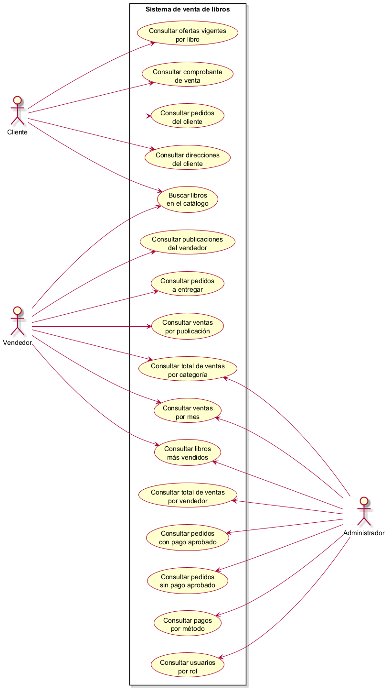

# Casos de uso - Etapa 4

Este documento reúne las consultas de la etapa: qué rol usa cada una, qué requisito de la consigna cubre y qué se considera una venta. Cómo funciona cada consulta se documenta por separado, en el documento que enlaza el nombre de su caso de uso.

## 1. Diagrama

Los actores son los tres roles de la [Descripción del caso](../etapa-01/descripcion-caso.md#3-usuarios). El diagrama se genera con PlantUML desde [casos-uso.puml](casos-uso.puml).

## 2. Requisitos cubiertos

La consigna pide tres consultas mínimas:

- **Factura/comprobante:** encabezado y detalle de una venta, con subtotal por renglón y total acumulado.
- **Reporte agregado:** total de ventas por vendedor o por categoría en un rango de fechas, con `GROUP BY`, `SUM` y `COUNT`.
- **Consulta avanzada:** al menos tres tablas unidas con `JOIN` y filtros con `HAVING` o subconsultas.

| Caso de uso                                                              | Actores                 | Requisito           | Script                                                                                                                             |
| ------------------------------------------------------------------------ | ----------------------- | ------------------- | ---------------------------------------------------------------------------------------------------------------------------------- |
| [Consultar ofertas vigentes por libro](ofertas-vigentes-por-libro.md)    | Cliente                 | —                   | [cliente/ofertas-vigentes-por-libro.sql](../../sql/consultas/cliente/ofertas-vigentes-por-libro.sql)                               |
| [Consultar comprobante de venta](factura-comprobante.md)                 | Cliente                 | Factura/comprobante | [cliente/factura-comprobante.sql](../../sql/consultas/cliente/factura-comprobante.sql)                                             |
| [Consultar pedidos del cliente](pedidos-del-cliente.md)                  | Cliente                 | —                   | [cliente/pedidos-del-cliente.sql](../../sql/consultas/cliente/pedidos-del-cliente.sql)                                             |
| [Consultar direcciones del cliente](direcciones-del-cliente.md)          | Cliente                 | —                   | [cliente/direcciones-del-cliente.sql](../../sql/consultas/cliente/direcciones-del-cliente.sql)                                     |
| [Buscar libros en el catálogo](buscar-libros-catalogo.md)                | Cliente, Vendedor       | —                   | [cliente/buscar-libros-catalogo.sql](../../sql/consultas/cliente/buscar-libros-catalogo.sql)                                       |
| [Consultar publicaciones del vendedor](publicaciones-del-vendedor.md)    | Vendedor                | —                   | [vendedor/publicaciones-del-vendedor.sql](../../sql/consultas/vendedor/publicaciones-del-vendedor.sql)                             |
| [Consultar pedidos a entregar](pedidos-a-entregar.md)                    | Vendedor                | —                   | [vendedor/pedidos-a-entregar.sql](../../sql/consultas/vendedor/pedidos-a-entregar.sql)                                             |
| [Consultar ventas por publicación](ventas-por-publicacion.md)            | Vendedor                | —                   | [vendedor/ventas-por-publicacion.sql](../../sql/consultas/vendedor/ventas-por-publicacion.sql)                                     |
| [Consultar total de ventas por categoría](total-ventas-por-categoria.md) | Vendedor, Administrador | Reporte agregado    | [vendedor-administrador/total-ventas-por-categoria.sql](../../sql/consultas/vendedor-administrador/total-ventas-por-categoria.sql) |
| [Consultar ventas por mes](ventas-por-mes.md)                            | Vendedor, Administrador | —                   | [vendedor-administrador/ventas-por-mes.sql](../../sql/consultas/vendedor-administrador/ventas-por-mes.sql)                         |
| [Consultar libros más vendidos](libros-mas-vendidos.md)                  | Vendedor, Administrador | Consulta avanzada   | [vendedor-administrador/libros-mas-vendidos.sql](../../sql/consultas/vendedor-administrador/libros-mas-vendidos.sql)               |
| [Consultar total de ventas por vendedor](total-ventas-por-vendedor.md)   | Administrador           | Reporte agregado    | [administrador/total-ventas-por-vendedor.sql](../../sql/consultas/administrador/total-ventas-por-vendedor.sql)                     |
| [Consultar pedidos con pago aprobado](pedidos-con-pago-aprobado.md)      | Administrador           | —                   | [administrador/pedidos-con-pago-aprobado.sql](../../sql/consultas/administrador/pedidos-con-pago-aprobado.sql)                     |
| [Consultar pedidos sin pago aprobado](pedidos-sin-pago-aprobado.md)      | Administrador           | Consulta avanzada   | [administrador/pedidos-sin-pago-aprobado.sql](../../sql/consultas/administrador/pedidos-sin-pago-aprobado.sql)                     |
| [Consultar pagos por método](pagos-por-metodo.md)                        | Administrador           | —                   | [administrador/pagos-por-metodo.sql](../../sql/consultas/administrador/pagos-por-metodo.sql)                                       |
| [Consultar usuarios por rol](usuarios-por-rol.md)                        | Administrador           | —                   | [administrador/usuarios-por-rol.sql](../../sql/consultas/administrador/usuarios-por-rol.sql)                                       |

Las once consultas sin requisito responden a necesidades frecuentes de cada rol: comparar las ofertas de un libro antes de comprarlo, seguir los propios pedidos, saber qué falta entregar o reponer, y controlar los cobros, los pagos y los usuarios del marketplace.

`control/control-carga-datos.sql` no figura porque no es un caso de uso: revisa la precarga de datos y forma parte de las [pruebas de la Etapa 3](../etapa-03/pruebas-validacion.md#4-datos-de-prueba). Se explica en [Control de carga de datos](control-carga-datos.md).

## 3. Qué se considera una venta

Una venta es un pedido con un pago aprobado. Este criterio lo aplican el comprobante, los reportes de ventas (total por vendedor, total por categoría, libros más vendidos, ventas por mes y ventas por publicación) y los pedidos a entregar; las consultas de pedidos con y sin pago aprobado separan los pedidos que lo cumplen de los que no.

- **La fecha de una venta es la de aprobación del pago** (`PAGO.fecha_pago`), no la de creación del pedido, que puede quedar pendiente varios días antes de pagarse. El comprobante la muestra como fecha de venta, y los reportes por rango de fechas cuentan cada venta en el período en que se aprobó su pago. Según RN25, esa fecha se registra al aprobarse el pago: los datos de prueba lo cumplen y, en la Etapa 5, lo hace [`usp_RegistrarVenta`](../../sql/tecnico/procedimientos_funciones/registrar_venta/script.sql).
- **Tener fecha de pago no implica que haya una venta.** Si un pago se aprueba sin stock libre para todo el pedido, o con el pedido fuera del estado pendiente, el cobro no concreta la venta: el pago queda cancelado y conserva su fecha como rastro (RN37). Por eso, las consultas de ventas filtran por el estado del pago y no por la presencia de esa fecha.
- **No se filtra por el estado del pedido.** Según RN19, el pedido se confirma cuando se aprueba su pago, así que el pago aprobado basta. Los [datos de prueba](../etapa-03/pruebas-validacion.md#4-datos-de-prueba) respetan esa regla, y `usp_RegistrarVenta` aplica los dos cambios en una misma transacción. La excepción es [Pedidos a entregar](pedidos-a-entregar.md), que además pide el estado confirmado para separar lo cobrado y sin entregar de lo ya entregado.
- **Un pedido puede tener varios intentos de pago, pero a lo sumo uno aprobado** (RN24, RN29). Las consultas que solo necesitan saber si el pedido es una venta usan `EXISTS`, para no repetir filas por cada intento. Las que muestran datos del pago o agrupan por su fecha, como el comprobante, los pedidos con pago aprobado, los pedidos a entregar y las ventas por mes, se unen directamente al pago aprobado: al haber uno solo, no se duplican filas.
- **El descuento no cambia los montos.** Es informativo (RN32): ninguna consulta lo aplica, y cada monto es la suma de cantidad × precio unitario de los renglones.

## 4. Organización por rol

Los scripts se reparten en carpetas según el rol para el que se pensó cada consulta. Como un pedido puede incluir libros de varios vendedores (RN16), la carpeta depende de los datos que muestra la consulta:

| Carpeta                   | Pensada para             | Qué muestran sus consultas                                     | Consultas |
| ------------------------- | ------------------------ | -------------------------------------------------------------- | --------: |
| `cliente/`                | Cliente                  | Datos de un cliente o de una de sus ventas, y el catálogo.     |         5 |
| `vendedor/`               | Vendedor                 | Datos de un solo vendedor, elegido con `@vendedor_id`.         |         3 |
| `vendedor-administrador/` | Vendedor y Administrador | Sumas por libro, categoría o período, sin identificar a nadie. |         3 |
| `administrador/`          | Administrador            | Datos de todos los vendedores o de clientes.                   |         5 |
| `control/`                | Equipo de desarrollo     | Verificación de la precarga; no es un caso de uso.             |         1 |

La carpeta indica para quién se pensó la consulta, no quién puede ejecutarla: los permisos corresponden a la seguridad de la Etapa 5.
